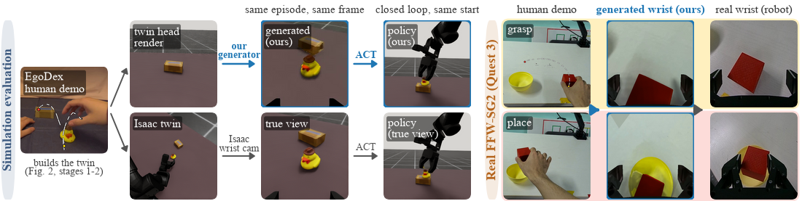
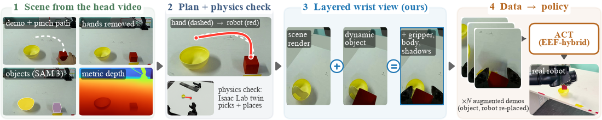

Head2Wrist: Wrist-Camera Robot Policies from Human Head-Camera Demonstrations without a Scene Scan
================================================================================================

[](https://umi-arena.airoa.io/)
[](docs/paper.pdf)
[](https://teamrobi.github.io/projects/head2wrist/)
[](LICENSE)


**Juno Kim** · **Yesol Park** · **Hye-Jung Yoon** · **Byoung-Tak Zhang** (corresponding author)  
Seoul National University



> **TL;DR:** Generate robot wrist-camera training views from a human's posed head-camera demonstration, with no separate scene scan or teleoperation. A policy trained on views generated from three Quest 3 demonstrations succeeds in 18 of 20 real cube-into-bowl trials.

## Abstract

Human head-camera demonstrations make up most large open manipulation datasets, but a robot trained on them meets two gaps: a moving human head rarely reproduces the robot's head view, and the arm in the images is human; inpainting a robot arm over it keeps the first. We instead train on the robot's wrist camera, whose view rides on the gripper, and generate it from a single human head-camera demonstration (posed head video and hand tracking), with no separate scene scan and no teleoperation. We reconstruct the scene from the pre-grasp head frame and nearby posed frames, plan a robot-executable, hand-aligned trajectory checked in a physics twin, and render the wrist views with layers matched to the robot's camera (dynamic object, gripper, robot body, cast shadows). In closed loop on the real FFW-SG2, a policy trained only on views generated from three Meta Quest 3 demonstrations (a cube into a bowl) succeeds in 18 of 20 trials from cube starts within 3 cm and 30° of a demonstrated one, where replaying the planned path open loop succeeds in 5. In a matched training-image comparison in Isaac Lab twins of six EgoDex scenes, with the generator given a clean twin head render and the object's exact geometry and start pose, ACT policies trained only on generated views show no detectable difference from true-view policies on three development scenes (all 9 paired p ≥ 0.12); on two held-out scenes they succeed less often in range (47/60 vs 58/60) and far less outside it (4/40 vs 27/40), and on a 1.4 cm-thin phone they succeed in 3 of 30 in-range trials (true view: 15).

## Method



1. Remove hands, estimate metric depth from nearby posed head frames, segment objects, and build a scene proxy with SAM 3D object meshes and an extended table.
2. Find a fixed base and lift stance, plan a hand-aligned TCP trajectory, and reject demonstrations that fail the Isaac Lab physics gate.
3. Render wrist views with the dynamic object, target-camera gripper texture, robot body and randomized cast shadows.
4. Re-plan for new object starts and stances, export LeRobot episodes, and train ACT with EEF-hybrid state/action representation and strong image augmentation.

## Contents

- [Installation](#installation)
- [Data](#data)
- [Usage](#usage)
- [Results](#results)
- [Repository layout](#repository-layout)
- [Citation](#citation)
- [Acknowledgements](#acknowledgements)
- [License](#license)

## Installation

The main environment uses **Python 3.11.14** and uv. Physics uses **Isaac Sim 5.1 / Isaac Lab 2.3**; ACT uses a separate **Python 3.10 / LeRobot 0.3.3** environment. See [INSTALL](docs/INSTALL.md) for dependencies and robot assets.

```bash
uv venv --python 3.11.14
source .venv/bin/activate
uv pip install -e '.[vision]'
bash third_party/lerobot/setup.sh
```

## Data

Download EgoDex from [apple/ml-egodex](https://github.com/apple/ml-egodex) following its dataset terms. Set `H2W_EGODEX_ROOT` to the directory containing `test/` episodes, or pass `--root` directly. See [DATA](docs/DATA.md) for the full layout and Quest conversion.

- [Quest 3 demonstrations](https://huggingface.co/datasets/jkim50104/Head2Wrist-quest-demos)
- [Generated cube-bowl floor training dataset (252 episodes)](https://huggingface.co/datasets/jkim50104/Head2Wrist-cube-bowl-252ep)
- [Paper ACT checkpoint (floor 80K)](https://huggingface.co/jkim50104/Head2Wrist-policy-cube-bowl)
- [Calibration and rendering assets](https://huggingface.co/datasets/jkim50104/Head2Wrist-cube-bowl-252ep)

Data and checkpoints are hosted on Hugging Face and stored outside git locally.

The author-confirmed paper model is [floor 80K](https://huggingface.co/jkim50104/Head2Wrist-policy-cube-bowl), trained on `lerobot_aug_floor`: three accepted demonstrations, 84 augmented episodes each, with seeds 1000/1001/1002. The floor recipe fits and clips the table-front edge, renders a floor 0.73 m below the tabletop with measured backdrop colour, propagates the corrected Quest focal length, and keeps the reconstructed object's native estimated size (`--obj_size` unset). The 18/20 real result is author-reported; per-trial logs were not saved.

## Usage

```bash
export H2W_DATA_ROOT="$PWD/data"
export H2W_OUTPUT_ROOT="$H2W_DATA_ROOT/outputs"
export H2W_EGODEX_ROOT="$H2W_DATA_ROOT/egodex/test"

# Head video + hand track -> physics-checked layered wrist clip
bash scripts/generate.sh --ep stack/48

# Quest/EgoKit capture -> the same EgoDex input format
bash scripts/convert_quest.sh --session "$H2W_DATA_ROOT/quest/session" \
  --calib "$H2W_DATA_ROOT/quest/calib.json" --task cube_bowl --idx 0 \
  --side right --description 'Put the cube into the bowl'
bash scripts/generate.sh --root "$H2W_DATA_ROOT/data/lab" --ep cube_bowl/0 --stance_args '--lift -0.25'

# After generating all three accepted demos: 84 episodes per demo, native object size
for K in 0 1 2; do
  bash scripts/augment.sh --ep "cube_bowl/$K" --workers 2
done
R="$H2W_OUTPUT_ROOT/real/cube_bowl"
bash scripts/export_lerobot.sh --demos "$R/augment/0/demos,$R/augment/1/demos,$R/augment/2/demos" \
  --wrist_from "$R/augment/0/views,$R/augment/1/views,$R/augment/2/views" --state eef \
  --scene cube_bowl_0 --root "$R/lerobot_aug_floor" --repo_id head2wrist/lerobot_aug_floor \
  --task 'Put the cube into the bowl'
# Defaults: floor dataset/run, EEF hybrid, strong augmentation, seed 1000, 80,000 steps
bash scripts/train_repr.sh
```

All Python tools also support `python -m head2wrist.<subpackage>.<module>`. [REPRODUCE](docs/REPRODUCE.md) maps paper results to commands; [ROBOT](docs/ROBOT.md) describes real deployment and isolated fake-follower tests. The default generator ends at `compose_v5`; optional video-model refinement is separate.

## Results

The following counts and ablations are transcribed from the main paper. Simulation uses clean twin head renders, the grasped object's exact geometry and start pose, matched trajectories/states/actions, and evaluation on the true wrist camera. No-difference tests are not equivalence tests.

| Evaluation | Generated-view policy | Comparator |
|---|---:|---:|
| Real FFW-SG2, cube into bowl | 18/20 | Open-loop replay: 5/20 |
| Held-out scenes, in range | 47/60 | True views: 58/60 |
| Held-out scenes, out of range | 4/40 | True views: 27/40 |
| Held-out scenes, moved base | 25/48 | True views: 35/48 |
| 1.4 cm-thin phone, in range | 3/30 | True views: 15/30 |

On stack/18, stack/48 and pick-place/25, all 9 paired comparisons have `p ≥ 0.12`. Held-out pooled exact McNemar `p = 0.003`, `< 10^-4`, `0.02` (in / out / moved). Generated-to-real replay views: SSIM 0.64, median misalignment 5.6 px; simulation: 0.84, 0.3 px.

| Setting (stack/18 unless noted) | In | Out | Moved |
|---|---:|---:|---:|
| joint-space ACT, fixed stance | 22/50 | 4/40 | 0/24 |
| EEF absolute, fixed stance | 45/50 | 22/40 | 2/24 |
| EEF hybrid, fixed stance | 45/50 | 27/40 | 7/24 |
| + stance randomization | 21/50 | 20/40 | 7/24 |
| + strong aug. (base generator) | 46/50 | 33/40 | 17/24 |
| + full generator | 47/50 | 29/40 | 18/24 |
| true views (same recipe) | 42/50 | 30/40 | 17/24 |
| generated, exact object (stack/48) | 29/30 | 6/20 | 17/24 |
| obj. error, median 1.2 cm / 3° | 25/30 | 5/20 | 15/24 |
| obj. error, median 3.0 cm / 6.5° | 18/30 | 2/20 | 12/24 |
| constant image (stack/48 + pick-place/25, stopped early) | 0/35 | 0/33 | 1/34 |

Object-error ablations also perturb size (median 2.5 / 4.9%).

| Generator | stack/48 in | out | moved | pick-place/25 in | out | moved |
|---|---:|---:|---:|---:|---:|---:|
| base | 3 | 0 | 3 | 6 | 3 | 2 |
| + colour | 25 | 5 | 14 | 4 | 2 | 3 |
| + seamless | -- | -- | -- | 27 | 12 | 12 |
| + body (full) | 29 | 6 | 17 | 30 | 14 | 21 |
| trials | 30 | 20 | 24 | 30 | 20 | 24 |

The paper reports negative pilot results for Lyra 2.0, GEN3C, Cosmos 3, VACE and Cosmos-Transfer2.5. Their large model implementations and exploration scripts are omitted. Optional setup recipes and small Transfer2.5 adapters in `baselines/` remain; their code and model licenses apply independently. At 20 demonstrations on stack/48, refined vs ours was 21/30 vs 20/30 in range and 12/24 vs 13/24 moved base, at 27 GPU-min per refined episode.

## Repository layout

```text
head2wrist/
  capture/       # Quest ingestion, conversion, self-calibration and round trip
  pipeline/      # generator, task batching, augmentation and export
  planning/      # metric reconstruction helpers and hand-aligned TCP planning
  scene/         # scene proxy, static objects, visibility and rendering
  rendering/     # dynamic object, gripper, robot body and shadows
  robot/         # kinematics, stance search, ROS 2 bridge and replay comparison
  simulation/    # Isaac twin export, physics replay and gate
  policy/        # expert data, ACT representations/training/evaluation/statistics
  assets/        # numeric TCP-camera and finger geometry calibration
baselines/       # optional Transfer2.5 adapter and Blender preparation
scripts/         # portable command-line entry points
third_party/     # setup scripts only; no vendored implementations
docs/            # installation, data, reproduction, robot guide and figures
```

## Citation

```bibtex
@inproceedings{kim2026head2wrist,
  title={Head2Wrist: Wrist-Camera Robot Policies from Human Head-Camera Demonstrations without a Scene Scan},
  author={Kim, Juno and Park, Yesol and Yoon, Hye-Jung and Zhang, Byoung-Tak},
  booktitle={CoRL 2026 Workshop on UMI Arena},
  year={2026}
}
```

## Acknowledgements

We thank the authors of [EgoDex](https://github.com/apple/ml-egodex), [EgoKit](https://arxiv.org/abs/2605.16797), [Depth Anything 3](https://github.com/ByteDance-Seed/Depth-Anything-3), [SAM 3](https://github.com/facebookresearch/sam3), [SAM 3D Objects](https://github.com/facebookresearch/sam-3d-objects), [LeRobot](https://github.com/huggingface/lerobot), [Isaac Lab](https://github.com/isaac-sim/IsaacLab), [ROBOTIS](https://github.com/ROBOTIS-GIT/ai_worker), Open3D, Pinocchio, LaMa and the optional video models. See [third-party dependencies](third_party/README.md) for pins and licenses.

## License

Released under the [MIT License](LICENSE). Third-party code, robot assets, datasets and model weights retain their own licenses and terms; they are downloaded separately.
